<!-- Profile Header -->
<h1 align="center">Hey there, I'm Inam Irshad 👋</h1>

  

  
  

<!-- Git Koi -->

  

---

## 🚀 About Me

- 🧠 Passionate about building meaningful, real-world tech.
- 🔧 Full Stack Dev | MERN | Spring Boot | Java | TS | Node.js
- 👨‍💻 Team Lead – Building smarter apps for a better world.
- 🌎 Language-friendly: Supporting English, Sinhala

---

## 🛠️ Tech Stack

### 👨‍💻 Languages & Frameworks

  

### 💾 Database & Dev Tools

  

---

## 📊 GitHub Stats & Activity

<!-- 

  
  

  

 -->

<picture>
  <source media="(prefers-color-scheme: dark)" srcset="https://raw.githubusercontent.com/ItsInam/ItsInam/output/pacman-contribution-graph-dark.svg">
  <source media="(prefers-color-scheme: light)" srcset="https://raw.githubusercontent.com/ItsInam/ItsInam/output/pacman-contribution-graph.svg">
  
</picture>

---

## 🌱 Currently Learning

- 🔐 Secure Authentication Flows (JWT, OAuth, Google Sign-In)
- ⚙️ Building Scalable Backends with Spring Boot
- 🤖 Experimenting with ML/AI integrations (Gemini API, LangChain)
- 🔄 Real-time Updates (WebSockets, SSE)

---

## 🔗 Connect With Me

  
  
  

---

## 💬 Let's Build Something Legendary Together! 🚀
